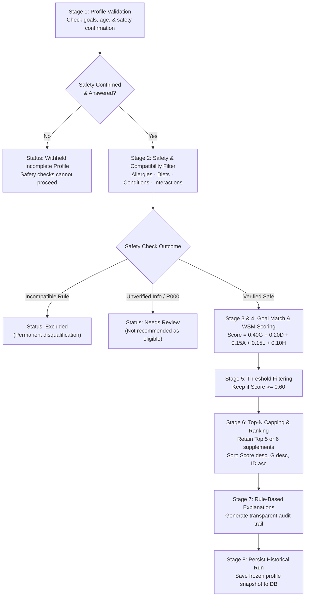

# Open Source Personalized Medicine & Supplement Recommendation Platform

**Academic Context:** B.Tech Computer Engineering Final Capstone Project  
**Specification:** Software Requirements Specification (SRS) Version 1.0, September 2026  
**Team:** Group 101  
**Architecture:** Decoupled Full-Stack Web Application (React 18 + Vite + TypeScript + Tailwind CSS / FastAPI + SQLAlchemy + Alembic + JWT)

---

## 1. Executive Summary

This platform is an open-source health informatics system designed to guide users in exploring supplement types tailored to their wellness goals, dietary restrictions, allergies, preexisting health conditions, activity level, sleep patterns, and prior usage.

### Expanded Supplement Catalogue (v0.2-expanded)
The knowledge base has been expanded from the initial 24 baseline records to **130 distinct generic supplement types** across 11 balanced nutritional categories. Every record includes active ingredients, commercial delivery forms, primary source identifiers, authoritative monograph links (NIH Office of Dietary Supplements, NCCIH Herbs at a Glance, and NLM MedlinePlus), and strict verification tracking.

| Metric | Baseline | Expanded Catalogue |
| :--- | :---: | :---: |
| **Total Distinct Supplement Types** | 24 | **130** |
| **Foundational IDs Preserved (SUP001–SUP024)** | 24 | **24 (100% preserved)** |
| **New Unique IDs Added (SUP025–SUP130)** | 0 | **106** |
| **Verified Monographs (Full Clinical Evidence)** | 24 | **46** |
| **Candidate / Review-Required Records (Rule R000)** | 0 | **84** |
| **Goal Mappings** | 20 | **85** (42 active verified) |
| **Safety Contraindication Rules** | 15 | **41** (R000–R040) |
| **Diet Compatibility Records** | 48 | **260** (Vegetarian & Vegan) |
| **Allergen Cross-References** | 2 | **10** |
| **Activity Level Mappings** | 4 | **12** |
| **Lifestyle / Sleep Mappings** | 2 | **7** |
| **Automated Test Suite (pytest)** | 23 | **35 passing tests** |

### Academic & Regulatory Constraint: Deterministic Rule-Based Logic
Under strict academic guidelines, **no generative AI, Large Language Models (LLMs), or black-box machine learning models are used to generate recommendations**. Healthcare decision support demands complete explainability, transparency, and clinical auditability. The platform employs:
- **Safety-First Pre-Filtering:** Contraindications, allergens, and dietary incompatibilities disqualify candidates before any scoring occurs.
- **Rule R000 (Safety Incompleteness Axiom):** "Unknown" is never treated as safe. Any candidate supplement lacking a verified safety record is routed to *Requires Review* and cannot be recommended as eligible.
- **Multi-Criteria Decision Analysis (Weighted Sum Model - WSM):** Deterministic weighted linear combination across 5 transparent criteria ($0.40G + 0.20D + 0.15A + 0.15L + 0.10H$).
- **Strict Threshold Cutoff & Top-N Capping:** Only candidates scoring $\ge 0.60$ proceed to ranking. To prevent polypharmacy and excessive pill burden, recommendations are capped to the **Top 5** (or user-configurable **Top 6**) highest-scoring candidates rather than returning all eligible rows.
- **Deterministic Tie-Breaking:** Stable ordering by Score descending, Goal Match score descending, and Supplement ID ascending.
- **Frozen Profile Snapshots:** Historical runs store an immutable copy of user profile state and algorithm versions so historical results never change retroactively.


> **Regulatory & Medical Disclaimer:** This platform is an educational guidance tool. It is not a diagnostic system, does not prescribe medications or supplements, and does not replace consultation with a qualified medical professional.

---

## 2. Supplement Categories & Distribution

The 130 supplements cover a balanced distribution across all common evidence-supported nutritional categories:

| Category Code | Display Name | Count | Key Supplement Examples |
| :--- | :--- | :---: | :--- |
| `vitamin` | Vitamin & Complexes | **17** | Vitamin D, Vitamin B12, B6, C, E, K, A, Folate, Biotin, B1, B2, B3, B5, B-Complex, Vitamin K2 (MK-7), Beta-Carotene, Inositol |
| `mineral` | Mineral & Trace Elements | **15** | Calcium, Iron, Magnesium, Zinc, Selenium, Iodine, Potassium, Copper, Manganese, Chromium, Molybdenum, Boron, Silicon, Vanadium, Multi-Mineral |
| `fatty_acid` | Omega-3 & Fatty Acids | **13** | Omega-3 Fatty Acids, EPA, DHA, Algal Oil, Cod Liver Oil, Krill Oil, Flaxseed Oil, Evening Primrose Oil, Borage Oil, Black Currant Seed Oil, CLA, ALA, MCT Oil |
| `protein_amino_acid` | Protein Supplements | **9** | Whey Protein Isolate, Whey Concentrate, Micellar Casein, Pea Protein, Soy Protein Isolate, Rice Protein, Hemp Protein, Egg White Protein, Collagen Peptides |
| `amino_acid_derivative`| Amino Acids & Derivatives | **14** | Creatine, L-Glutamine, BCAA, EAA, L-Arginine, L-Citrulline, Beta-Alanine, L-Carnitine, Taurine, L-Tyrosine, L-Theanine, Glycine, NAC, L-Lysine |
| `electrolyte` | Electrolytes & Hydration | **5** | Electrolyte Replacement Complex, Sodium Chloride, Potassium Citrate, Magnesium Malate, Oral Rehydration Salts (ORS) |
| `fiber_prebiotic` | Fiber & Prebiotics | **8** | Psyllium Husk, Inulin / FOS, Acacia Fiber, Glucomannan, Partially Hydrolyzed Guar Gum (PHGG), Apple Pectin, Arabinogalactan, Resistant Starch |
| `probiotic` | Probiotics & Microbes | **6** | Probiotics (Multi-strain), Saccharomyces boulardii, Lactobacillus rhamnosus GG, Bifidobacterium infantis, Bacillus coagulans, Synbiotic Complex |
| `botanical` | Herbal & Botanical | **29** | Ashwagandha, Turmeric, Ginkgo, Echinacea, Garlic, Ginseng, Rhodiola, Milk Thistle, Valerian Root, St. John's Wort, Green Tea (EGCG), Ginger, Boswellia, Elderberry, Saw Palmetto, Berberine, Maca, Holy Basil, Bacopa, Cordyceps, Lion's Mane, Reishi, Bilberry, Cranberry, Hawthorn, Passionflower, Tart Cherry, Red Yeast Rice |
| `nutrient` | Nutrients & Cellular Factors | **13** | Choline, Coenzyme Q10 (CoQ10), Alpha-Lipoic Acid, Resveratrol, Astaxanthin, Lutein & Zeaxanthin, Quercetin, Spirulina, Chlorella, Glucosamine, Chondroitin, MSM, SAMe |
| `hormone_supplement` | Hormone Supplements | **1** | Melatonin |
| **Total** | | **130** | |

---

## 3. Data Architecture & Canonical Roles

This project maintains distinct data directories to balance canonical reproducible dataset generation, test suite isolation, and verified clinical review:

```
project/
├── dataset/
│   ├── build.py                # Reproducible canonical dataset builder
│   ├── supplement_data.py      # Authoritative data definitions (130 records + mappings)
│   ├── validate_dataset.py     # Structural & relational dataset validator
│   └── data/                   # CANONICAL TRUTH: Canonical draft dataset generated by build.py
└── backend/
    ├── create_verified_dataset.py  # Verified dataset curation pipeline
    ├── data/                       # Backend draft copy (synchronous with dataset/data)
    └── data_verified/              # Active production dataset with verified monographs & active rules
```

### Directory Roles & Synchronization
1. **`dataset/data/` (Canonical Truth):** Built directly by `dataset/build.py`. Defines all 130 supplements, vocabularies, candidate maps, and default rule R000.
2. **`backend/data/` (Backend Draft Replica):** Automatically synchronized with `dataset/data/` whenever `build.py` runs. Used in testing (`DATA_DIR="data"`) to verify that unverified datasets are completely withheld under Rule R000.
3. **`backend/data_verified/` (Active Monograph Dataset):** Generated from `backend/data/` via `backend/create_verified_dataset.py` (or automatically via `build.py`). Contains 46 fully verified monographs, 42 activated goal mappings, 41 activated safety rules, and verified dietary compatibility. Candidate supplements remain marked `needs_review` so Rule R000 routes them to professional review.

---

## 4. The 8-Stage Recommendation Algorithm



### WSM Scoring Formula & Weights

$$\text{Relevance Score} = 0.40G + 0.20D + 0.15A + 0.15L + 0.10H$$

| Symbol | Criterion | Weight | Scoring Range & Logic |
| :---: | :--- | :---: | :--- |
| **G** | Goal Match | **0.40** | Direct match = 1.0; Partial match = 0.5; No match = 0.0 |
| **D** | Dietary Fit | **0.20** | Omnivore or verified compatible = 1.0; Incompatible = 0.0 (and excluded) |
| **A** | Activity Match | **0.15** | Direct match = 1.0; Partial match = 0.5; Unmapped = 0.0 |
| **L** | Lifestyle & Sleep | **0.15** | Direct sleep match = 1.0; Partial = 0.5; Unmapped = 0.0 |
| **H** | Previous Usage | **0.10** | Used with no reaction = 1.0; Never used = 0.5; Reaction reported = 0.0 (and flagged for review) |

---

## 5. Execution Commands (Windows PowerShell)

All commands are validated for Windows PowerShell.

### Step 1: Regenerate Dataset & Synchronize (Reproducible Build)
```powershell
python dataset\build.py
```
*Outputs:*
- Canonical CSVs in `dataset\data\`
- Synchronized replica in `backend\data\`
- Verified monograph dataset in `backend\data_verified\`

### Step 2: Validate Dataset Integrity
```powershell
# Validate canonical dataset
python dataset\validate_dataset.py dataset\data

# Validate active verified dataset and check cross-synchronization
python dataset\validate_dataset.py backend\data_verified --compare-with dataset\data
```

### Step 3: Run Database Migrations
```powershell
cd backend
alembic upgrade head
cd ..
```

### Step 4: Import Knowledge Base into Database (Idempotent)
```powershell
python import_dataset.py backend\data_verified
```

### Step 5: Run Automated Test Suite (34 Passing Tests)
```powershell
cd backend
python -m pytest -v
cd ..
```

### Step 6: Build & Test Frontend
```powershell
cd frontend
npm install
npm run build
cd ..
```

### Step 7: Launch Application
```powershell
# Terminal 1: Backend API
cd backend
uvicorn app.main:app --reload --port 8000

# Terminal 2: Frontend Dev Server (Optional, if not single-port serving)
cd frontend
npm run dev
```

---

## 6. How to Add a New Supplement Correctly

To add a new supplement (e.g. `SUP131`):
1. **Define Record in `dataset/supplement_data.py`:**
   - Add a tuple to `SUPPLEMENT_RECORDS`: `(supplement_id, name, category, description, active_ingredients, forms, primary_src, url, is_verified_monograph, notes)`.
   - Ensure the name is distinct and generic (not a commercial brand).
   - Use an authoritative source (NIH ODS, NCCIH, MedlinePlus).
2. **Add Related Mappings:**
   - Goal mappings in `GOAL_MAPPINGS_DEF` with evidence notes and citations.
   - Dietary compatibility in `build.py` (vegetarian/vegan compatibility).
   - Allergen relations in `ALLERGEN_MAPPINGS_DEF` if applicable.
   - Safety rules in `SAFETY_RULES_DEF` for known contraindications or drug interactions.
3. **Regenerate & Validate:**
   ```powershell
   python dataset\build.py
   python dataset\validate_dataset.py backend\data_verified --compare-with dataset\data
   ```
4. **Run Tests & Import:**
   ```powershell
   cd backend; python -m pytest; cd ..
   python import_dataset.py backend\data_verified
   ```
